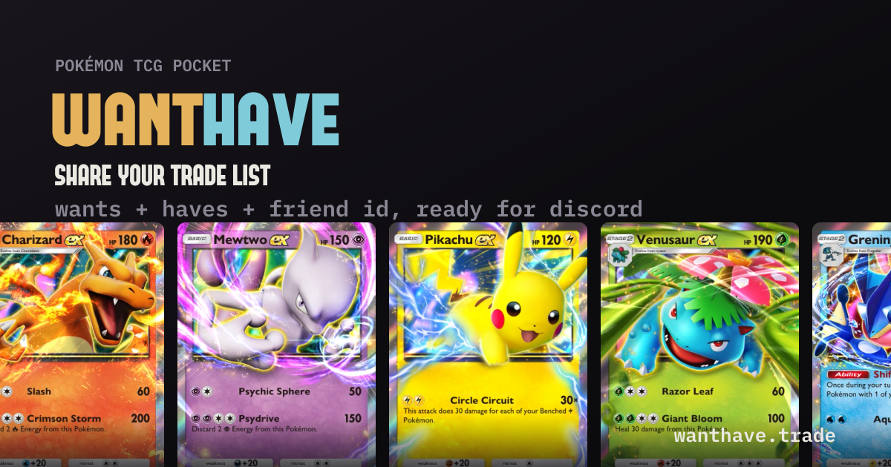

# wanthave

[](https://github.com/alexpricedev/wanthave/actions/workflows/ci.yml)

Build a Pokémon TCG Pocket trade list and share it as a single link. Post the
link in Discord and it unfurls with an image of the cards you're looking for —
no screenshots, no retyped shorthand, no separate friend-ID message.

[**wanthave.trade**](https://wanthave.trade) · [Functional spec](PRD.md) ·
[Design system](DESIGN.md)



## What it does

- **Build a list in under two minutes, no account.** Two sections — *looking for*
  and *for trade* — filled from a visual set browser or a search box that
  understands community shorthand ("RR chsr EX", "shiny pika", "FA trainer").
- **Only tradeable cards.** Rarity rules are enforced from the catalogue, and
  lists are grouped by rarity so a viewer can see what matches at a glance.
- **A shareable link that unfurls.** Every list gets a per-list 1200×630 OG
  image, rendered with the real card art, deep lists fanned out like a hand.
- **One-tap friend ID.** The 16-digit code is validated once and shown with a
  copy button on the public page.
- **Anonymous lists expire after 90 days — gracefully.** An expired link explains
  itself and keeps the call to create your own; it never 404s.
- **Accounts, when you want permanence.** An optional display name (it leads the
  embed title), permanent links, multiple named lists, and in-place editing that
  updates a link you already pinned in Discord.

## Stack

Bun serves everything in one process: the HTTP server, the JSX templates
(server-rendered, no hydration), and the assets. PostgreSQL through Bun's built-in
`Bun.SQL` — no ORM. `sharp` renders OG images and resizes card art. The only
client-side JavaScript is per-page islands written in Preact. Migrations run
automatically at boot, and Biome + `tsc` gate the build.

## Quick start

You'll need [Bun](https://bun.sh) 1.3+ and PostgreSQL 16+.

```bash
bun install
cp .env.example .env            # fill in DATABASE_URL, then generate a pepper
cp .env.test.example .env.test  # point it at your test database
bun run generate:pepper         # paste the output into CRYPTO_PEPPER
createdb wanthave && createdb wanthave-test
bun run dev
```

Open <http://localhost:3000>. Migrations apply automatically on startup, and an
`admin@example.com` admin user is seeded into an empty database.

Card art is served from object storage, so a fresh checkout renders placeholders
until you configure a bucket and mirror the images — see
[Card data and art](#card-data-and-art). Everything else works without it.

## Configuration

Environment variables are validated at startup; the server refuses to boot if a
required one is missing. [`.env.example`](.env.example) documents every one.

| Variable | Required | Notes |
| --- | --- | --- |
| `DATABASE_URL` | yes | PostgreSQL connection string |
| `CRYPTO_PEPPER` | yes | HMAC key for sessions, CSRF tokens and flash cookies. `bun run generate:pepper` |
| `PORT` | yes | `3000` locally; most hosts inject it |
| `APP_NAME` | yes | Used in mail and the wordmark |
| `APP_URL` | yes | Origin used for links in email; must match the request origin exactly or CSRF validation rejects form posts |
| `EMAIL_PROVIDER` | yes | `console` in development, `resend` in production |
| `FROM_EMAIL`, `FROM_NAME` | yes | Sender identity — must be on a verified domain when using Resend |
| `SITE_URL` | no | Public origin for canonical URLs, sitemap and JSON-LD. Defaults to `https://wanthave.trade`, so **set this when self-hosting** |
| `RESEND_API_KEY` | with Resend | See [runbooks/EMAIL.md](runbooks/EMAIL.md) for SPF/DKIM/DMARC |
| `REPLY_TO_EMAIL`, `FEEDBACK_TO_EMAIL` | no | Monitored reply address; where `/feedback` is delivered |
| `SECURITY_CONTACT` | no | Sets the `/.well-known/security.txt` contact |
| `SESSION_COOKIE_NAME` | no | Defaults to `session_id`; set it if several apps share `localhost` |
| `MAINTENANCE_MODE`, `MAINTENANCE_RETRY_AFTER` | no | Serve a 503 with `Retry-After` everywhere but `/health` |
| `S3_ENDPOINT`, `S3_REGION`, `S3_BUCKET`, `S3_ACCESS_KEY_ID`, `S3_SECRET_ACCESS_KEY` | for card art | See below |

## Card data and art

The catalogue (`src/server/data/cards.json`, ~4,000 tradeable cards) is checked
in, so the app runs without a card database. It's built from pluggable providers
in `src/tools/cards/` — `CARD_SOURCE` picks the dataset, `CARD_ENRICHERS` layers
optional fields on top (`CARD_ENRICHERS=` builds an MIT-only catalogue).
Rebuilding for a new set is a short manual routine —
[docs/adding-a-set.md](docs/adding-a-set.md).

Card art is **not** in the repo. The app reads it from an S3-compatible bucket as
`cards/<card-id>.webp` and caches it on disk after the first read. Point the
`S3_*` variables at a bucket and populate it:

```bash
bun run scripts/sync-card-art.ts            # new art only
bun run scripts/sync-card-art.ts --dry-run  # report what's missing
```

The artwork itself belongs to Nintendo / The Pokémon Company — see
[NOTICE.md](NOTICE.md) before you host it.

## Scripts

| Command | What it does |
| --- | --- |
| `bun run dev` | Client, server and CSS watchers on :3000 |
| `bun run build` | Minified client JS and CSS into `dist/assets` |
| `bun run start` | Production server (build first) |
| `bun run test` | Full suite against the database in `.env.test` |
| `bun run check` | Biome + `tsc --noEmit`, zero warnings allowed |
| `bun run lint:write` | Apply Biome fixes |
| `bun run migrate:up` / `:status` / `:create` | Migration CLI (they also run at boot) |
| `bun run seed` | Seed the admin user into an empty database |
| `bun run scripts/build-cards.ts` | Rebuild the card catalogue from the source datasets |
| `bun run scripts/sync-card-art.ts` | Mirror card art into the bucket |
| `bun run scripts/build-brand.ts` | Regenerate favicons, wordmark and the static OG image |

## Project structure

```
src/
├── client/            # Browser code: page controllers, CSS, Preact islands
├── tools/             # Offline tooling: card catalogue providers and build
└── server/
    ├── main.ts        # Boot: env validation, migrations, Bun.serve
    ├── routes/        # Thin route maps (views, API, admin)
    ├── controllers/   # Orchestration: service → template or JSON
    ├── templates/     # Server-rendered JSX pages
    ├── components/    # Shared JSX
    ├── services/      # Business logic and data access
    ├── middleware/    # Auth, CSRF, rate limiting
    ├── database/      # Migrations and migration CLI
    └── utils/         # Response helpers, crypto, env validation, headers
```

Controllers never query the database; templates receive fully resolved props,
which is why page tests can assert on rendered HTML without a browser.

## Testing

```bash
bun run test
```

Runs with the `NODE_ENV=test` environment from `.env.test` against a real
PostgreSQL database (truncating between tests). Copy `.env.test.example` to
`.env.test` and point `DATABASE_URL` at a throwaway database first. Controller
tests mock the service layer and assert on actual `Response` objects; client
scripts run under happy-dom.

## Deploy

Anywhere that can run `bun run start` works — Railway, Fly.io, Render, or a VPS.
`railway.json` is included with the build and start commands preconfigured and a
`/health` check.

1. Push the repo to GitHub and connect it to your host.
2. Add PostgreSQL and link it so `DATABASE_URL` is set.
3. Set the required variables, plus `SITE_URL` and the `S3_*` group.
4. Deploy — migrations run before the first request is served.

Before you take real traffic, work through the operator checklists: TLS and
headers ([runbooks/SECURITY.md](runbooks/SECURITY.md)), email deliverability
([runbooks/EMAIL.md](runbooks/EMAIL.md)), indexing
([runbooks/SEO.md](runbooks/SEO.md)), and merge protection
([runbooks/CI.md](runbooks/CI.md)).

## Contributing

Issues and PRs are welcome — start with [CONTRIBUTING.md](CONTRIBUTING.md), and
note that participation is covered by the
[Code of Conduct](CODE_OF_CONDUCT.md). Security issues should go through
[SECURITY.md](SECURITY.md), not the issue tracker.

## Credits and licence

Application code is MIT licensed ([LICENSE](LICENSE)). The card catalogue derives
from community datasets under their own terms, the fonts have their own licences,
and the card art belongs to The Pokémon Company — all documented in
[NOTICE.md](NOTICE.md).

wanthave is an independent, unofficial tool. It is not affiliated with, endorsed
by, or sponsored by Nintendo, Creatures Inc., GAME FREAK inc., or The Pokémon
Company.
